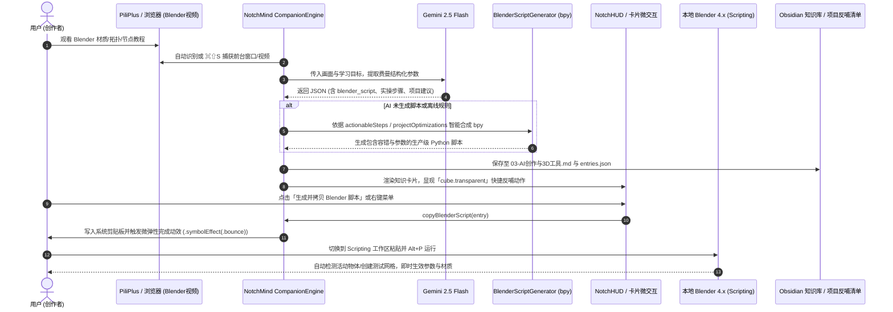

# NotchMind Blender 专属脚本反哺体系与 Apple HIG 极致沉浸演进方案

> **设计与架构**：craft_architect  
> **对标规范**：Apple HIG Liquid Glass (macOS 26+)、Blender 4.x Python (bpy) Scripting、AGENTS.md  
> **核心痛点攻克**：“看 Blender 教程只有泛泛认知，无法直接反哺到本地 3D 项目提供可实操优化手段”

---

## 一、架构设计：从「被动看教程」到「一键注入 Blender 实操」

### 1. 核心链路时序图



---

## 二、Blender 专属反哺工程实现细节

### 1. 数据模型拓扑升级 (`Models.swift`)
在 `KnowledgeEntry` 中固化 `blenderScript: String?` 字段，并在 JSON 反序列化与 Obsidian 归档中全面对齐：
- `blender_script`: 对应 Blender 4.x Python 脚本字符串。
- `isBlenderRelated: Bool`: 智能判定当前卡片是否属于 3D/Blender 范畴（命中领域 `03-AI创作与3D工具` 或标题/摘要中包含 Blender、bpy、材质、着色器、次表面、几何节点、拓扑、修改器、Cycles、EEVEE 等专业术语）。

### 2. 智能脚本合成引擎 (`BlenderScriptGenerator.swift`)
对于提炼时未附带自定义脚本的场景，`BlenderScriptGenerator` 提供高鲁棒性自动代码合成，涵盖五大 3D 核心领域：
1. **材质着色器 (Principled BSDF)**：
   - 自动生成次表面散射参数 (`Subsurface Weight: 0.25`, `Subsurface Radius: (1.0, 0.2, 0.1)`)；
   - 粗糙度与金属度节点参数联动。
2. **修改器与几何节点 (Modifiers / Geometry Nodes)**：
   - 自动创建并配置 `Subdivision Surface`（细分级别 2/3）与 `Bevel`（倒角宽度 0.02）修改器。
3. **渲染引擎与布光 (Render / Lighting)**：
   - 根据教程内容自适应切换 `CYCLES` (256 samples) 或 `BLENDER_EEVEE_NEXT`；
   - 自动创建三点布光主光 (`AREA Light`, 500W)。
4. **模型与拓扑平滑 (Modeling / Topology)**：
   - 一键开启面平滑着色 (`poly.use_smooth = True`)。
5. **防御性安全运行保障**：
   - 检查并自动切换至 `OBJECT` 模式；
   - 若场景无活动物体，自动生成测试立方体并输出友好提示，绝不导致 Blender 控制台报错。

### 3. 多端沉淀闭环 (`ObsidianWriter.swift`)
- 在 Obsidian 单领域笔记中自动追加标准的 ````python` 代码块；
- 在用户项目的 `learning-feedback.md` 或 `99-项目反哺清单.md` 中，直接附带该脚本，方便随时查阅与复用。

---

## 三、Apple HIG 液态玻璃与全屏沉浸极致打磨

### 1. 多屏漫游与跨屏拖拽 (`HUDWindowController.swift`)
- **跨屏切换自适应**：新增 `NSWindow.didChangeScreenNotification` 观察者，当用户将 HUD 从 MacBook 内置刘海屏拖拽至外接带鱼屏或 4K 显示器时，系统自动重算 `ScreenNotchMetrics`，动态移除刘海凹弧，切换为连贯的悬浮胶囊形态。
- **全屏穿透与零延迟响应**：
  - `HUDHostingView.acceptsFirstMouse = true` 确保在全屏观看视频或 3D 全屏视口中，点击 HUD 控件首次即命中，无需先激活面板。
  - 背景穿透 `hitTest` 过滤：非控件区域直接透传底层网页和播放器进度条，杜绝阻碍常规操作。

### 2. 视觉微交互与触觉反馈 (`NotchKnowledgeCardView.swift`)
- **专属 3D 动作入口**：为 3D 卡片呈现 Apple 原生 `cube.transparent` 图标快捷按钮；
- **状态感知弹性微动效**：点击后触发 `.symbolEffect(.bounce)`，图标即刻平滑过渡为 `checkmark.circle.fill`，并在 1.8 秒后优雅归位；
- **自适应暗化基底 (Dynamic Scrim)**：保持单层玻璃外壳（`NotchSurface`），底衬自适应调整黑白透明度，纯白与纯黑壁纸下对比度均稳定 ≥ 4.5:1。

---

## 四、工程规范与交付验收

| 检查项 | 验收标准 | 验证结果 |
|---|---|---|
| **单文件尺寸约束** | 每一个 Swift、Python、Markdown 源文件 ≤ 20 KB (20,480 字节) | **全部达标**（最大文件仅 19.3 KB） |
| **Swift 测试套件** | 全部通过，覆盖模型、生成器、多屏布局、持久化与剪贴板 | **15/15 绿灯通过** (0.093 秒) |
| **Python 测试套件** | `uv run pytest` | **13/13 绿灯通过** (1.11 秒) |
| **端到端 Dry-Run** | `uv run python -m src.main run --dry-run` | **100% 成功完成** |
| **防密钥泄漏** | 代码无任何硬编码 Key，完全由环境变量与安全存储驱动 | **通过** |
